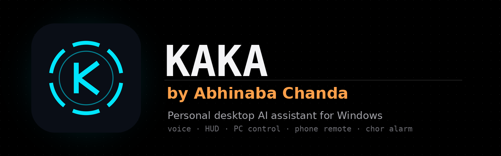
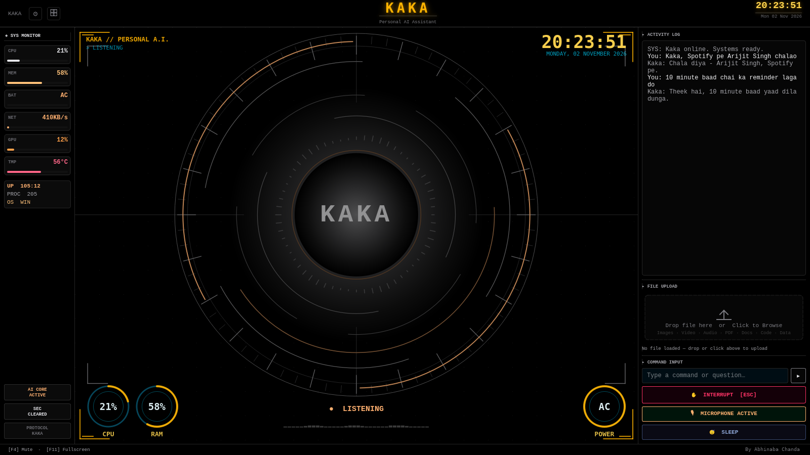
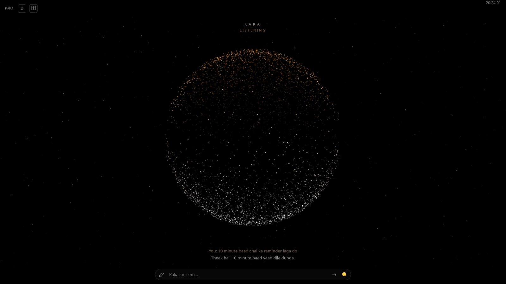
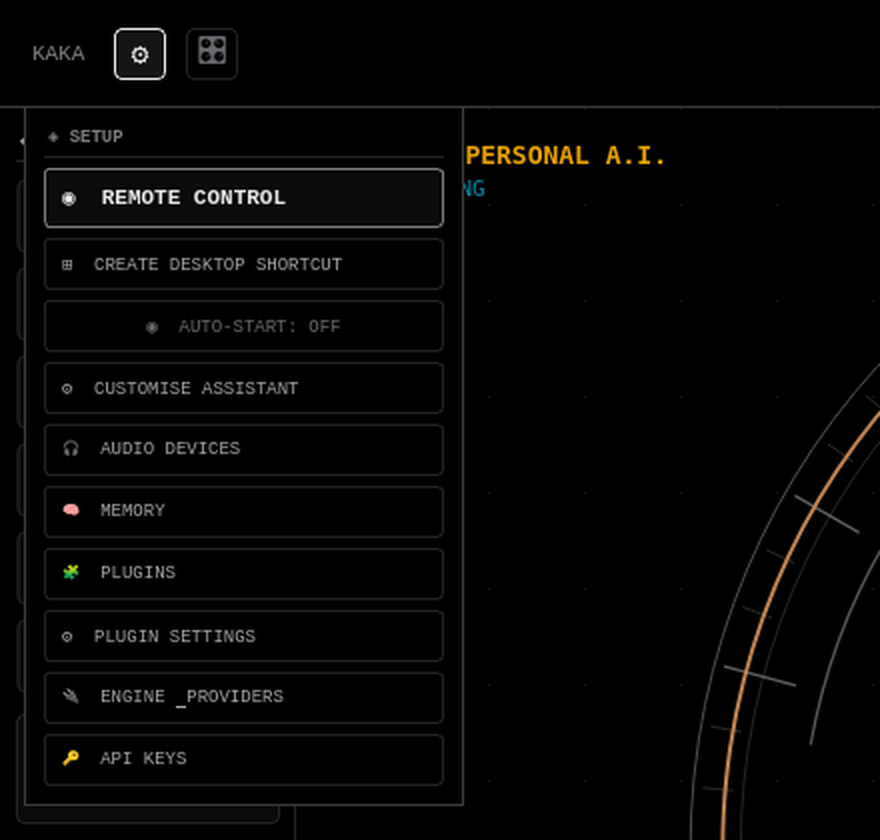
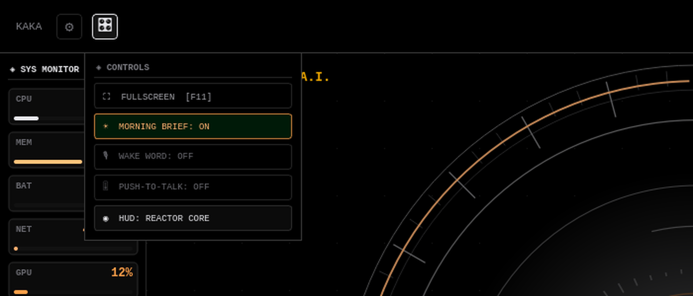

<div align="center">



# Kaka by Abhinaba Chanda

**A personal desktop AI assistant for Windows. You talk to it in Hinglish or English, it answers in a voice, shows a sci-fi HUD, runs your PC and listens to your phone.**


</div>

---

## Contents

1. [What Kaka is](#what-kaka-is)
2. [Screenshots](#screenshots)
3. [Features](#features)
4. [Voice commands (examples)](#voice-commands-examples)
5. [Hotkeys](#hotkeys)
6. [The two menus: SETUP and CONTROLS](#the-two-menus-setup-and-controls)
7. [Discord phone remote](#discord-phone-remote)
8. [Requirements](#requirements)
9. [API keys (all free to start)](#api-keys-all-free-to-start)
10. [Folders Kaka creates](#folders-kaka-creates)
11. [Install, step by step](#install-step-by-step)
12. [Discord bot setup](#discord-bot-setup)
13. [Optional parts (face, gestures, wake word, recording)](#optional-parts-face-gestures-wake-word-recording)
14. [Troubleshooting](#troubleshooting)
15. [Project structure](#project-structure)
16. [Privacy and safety](#privacy-and-safety)

---

## What Kaka is

**Kaka by Abhinaba Chanda** is the assistant that runs on my own Windows PC every day. Say "Kaka", talk normally, and it:

- answers in a natural voice (Gemini Live, about one second to reply),
- opens apps, plays Spotify and YouTube, makes WhatsApp and Discord calls, controls volume, brightness and media,
- keeps notes, reminders, alarms, timers and a memory of things you tell it,
- reads your screen and explains errors, helps in VS Code,
- greets you by face, and sends a **chor alarm** (thief alarm) photo to your phone if someone else opens your PC,
- records your screen with the GPU (NVENC),
- takes commands from your phone through your own Discord bot,
- gives you a morning brief (weather, football, headlines).

If one AI provider is busy or out of free quota, Kaka moves down a chain of free providers, so it keeps answering.

This repository is the exact code that runs on my PC: the app folder (`app/`) and the source of the small `Kaka.exe` launcher (`Kaka-src/`). Only my private keys and settings are left out, and you add your own (see [API keys](#api-keys-all-free-to-start)).

---

## Screenshots

These are renders of the real Kaka window (the code in this repo, run at 1600×900).

**Reactor Core (full HUD):** SYS MONITOR on the left, the reactor in the middle, the activity log and file upload on the right.



**Minimal sphere:** black screen, one amber particle sphere, a type box and a file button at the bottom.



**Gear icon → SETUP menu** and **grid icon → CONTROLS menu:**

| SETUP | CONTROLS |
|---|---|
|  |  |

Full-size: [SETUP menu](docs/screenshots/menu-setup.png) · [CONTROLS menu](docs/screenshots/menu-controls.png)

---

## Features

| Feature | What it does |
|---|---|
| **Voice + AI fallback** | Gemini Live listens and speaks. If Gemini hits its limit, Kaka moves down the brain chain (below). |
| **Brain chain** | Gemini (main key, plus up to 4 more Gemini keys) → Groq → Mistral → NVIDIA NIM → OpenRouter → Cohere → Cloudflare / SambaNova → 6 custom slots (any OpenAI-compatible API). Order and keys are set in SETUP → API KEYS / ENGINE PROVIDERS. |
| **Wake word** | Say "Kaka" (also "hey Kaka", "okay Kaka"). Offline, using a small Vosk model downloaded once (about 40 MB). |
| **Hinglish** | Talk in Hinglish, English, or Bengali in English letters. Kaka answers in short Hinglish. |
| **Confirm rule** | Before anything that sends, deletes, buys, posts, installs or overwrites, Kaka asks once. A direct "call lagao" rings without asking. |
| **Two HUD looks** | Reactor Core (full HUD) and Minimal sphere. Switch in CONTROLS → HUD. |
| **WhatsApp** | Calls and messages through the WhatsApp desktop app. It checks the chat name before calling, so a wrong chat means no call. |
| **Discord call** | Voice or video call someone in the Discord app. |
| **Spotify** | Songs, your playlists, Liked Songs, shuffle, pause, next. |
| **YouTube** | Opens the first real video in your browser, then controls it with YouTube's own keys. |
| **VS Code helper** | Runs the open file, explains errors, suggests a fix and asks before writing (keeps a `.bak`). C, C++, Python, Java, JS and Node. |
| **Apps and files** | Opens desktop apps first (not the browser). A file finder indexes your drives every 30 minutes. |
| **PC control** | Exact volume, mute, brightness, media keys, lock, sleep. Shutdown and restart need a confirm. |
| **PC health** | Battery, CPU, RAM, disk, top apps, GPU temperature. Low-battery alerts at 20% and 10%. |
| **Reminders and alarms** | Beep + popup + voice, even when Kaka is asleep. Saved, so they survive a restart. |
| **Timer, stopwatch, pomodoro** | Countdown on the HUD. |
| **Notes panel** | An always-on-top notes card in the top-right corner. Ctrl+2 shows or hides it. |
| **Clipboard memory** | The last 20 text copies. Passwords, OTPs and API keys are skipped. |
| **Memory** | "yaad rakhna …" saves a fact that Kaka uses in every chat. View, edit or clear it in SETUP → MEMORY. |
| **Screenshot** | Saved to `Data\Screenshots`. Can also send it on WhatsApp (asks first). |
| **Screen explain + translate** | "ye error kya hai", "screen ka text Bengali mein": uses Gemini vision with your key. |
| **Morning brief** | Every day at 8:00 AM, or when you ask: weather (Kolkata by default), FC Barcelona's last result and next match in IST, and 3 India headlines. On/off in CONTROLS. |
| **Weather, news, football** | Live sources: Open-Meteo, ESPN, Google News. |
| **Game mode** | Turns on by itself in full-screen games (or by voice). Kaka goes quiet, the mic is muted and reminders wait. Alarms still ring. |
| **Sleep mode** | Ctrl+1 or the SLEEP button. Kaka stops listening and stays quiet until you wake it. |
| **Boot intro** | First start after Windows boots: a 3.6 second arc-reactor animation and "Good evening … Systems online." with time, battery, reminders and weather. |
| **Face greet** | Learns your face once (only numbers are saved, not a photo of you) and greets you by name on boot and after 10+ minutes away. |
| **Chor alarm** | When the PC is unlocked or woken, the camera looks. An unknown face → photo to your phone (Discord) and a copy in `Data\Alarm`. |
| **Screen recording** | MP4 with NVIDIA NVENC GPU encoding (CPU fallback), optional mic, a red REC dot on the HUD, and "save the last 30 seconds". |
| **Hand gestures** | With the camera: open palm = play/pause, thumbs up = next, thumbs down = previous, one finger up/down = volume, V sign = wake Kaka. |
| **Email and letters** | Opens Gmail compose already filled in. It never sends by itself. |
| **Discord phone remote** | Control the PC from your phone through your own Discord bot (below). |
| **Phone dashboard** | SETUP → REMOTE CONTROL shows a QR code and a key for the built-in phone dashboard on your Wi-Fi. |
| **Timing log** | Each task's time goes to `Data\kaka-timing.txt` (say "timing"). |
| **Kaka.exe launcher** | Starts Kaka without a black console window, autostarts at Windows login from the Startup folder (no admin), and has `--restart`, `--stop` and `--voice-toggle`. |
| **K logo everywhere** | The window, taskbar, Kaka.exe, shortcuts, dashboard and the Discord bot's photo. |

---

## Voice commands (examples)

Say "Kaka" first (or press the HUD mic button, or type in the box at the bottom). These are examples; normal Hinglish or English works too.

| You say | Kaka does |
|---|---|
| "Maa ko WhatsApp call karo" · "Call Didi on WhatsApp" | WhatsApp voice call |
| "Didi ko message bhejo: main 10 min mein aa raha hoon" | WhatsApp message (asks once before sending) |
| "Rahul ko Discord pe call karo" | Discord call |
| "Kesariya chalao" · "meri playlist chalao" · "liked songs shuffle karo" | Spotify |
| "gaana pause" · "next song" · "volume 40" · "mute" · "brightness 70" | Media, volume, brightness |
| "YouTube pe Kesariya chalao" · "agla video" · "fullscreen" | YouTube in your browser |
| "Chrome kholo" · "VS Code kholo" · "meri resume file kholo" | Apps and files |
| "ye file run karo" · "error fix karo" · "C mein calculator likho" | VS Code helper |
| "battery kitni hai" · "PC slow kyun hai" · "PC garam hai kya" | PC health |
| "10 minute baad chai yaad dilana" · "kal subah 7 baje alarm" · "mere reminders batao" | Reminders and alarms |
| "25 minute ka timer" · "stopwatch shuru" · "pomodoro shuru" | Timers |
| "note karo doodh lana hai" · "mere notes padho" · "note 2 ho gaya" | Notes panel |
| "jo copy kiya tha woh batao" · "3 copy pehle wala" · "clipboard saaf karo" | Clipboard memory |
| "yaad rakhna Didi ka birthday 5 March hai" · "kya yaad hai mere baare mein" · "ye bhool jao" | Memory |
| "screenshot lo" · "screenshot lo aur Didi ko WhatsApp pe bhejo" | Screenshot |
| "ye error kya hai" · "screen ka text Bengali mein batao" | Screen explain / translate |
| "aaj ka update" · "morning update band karo" / "chalu karo" | Morning brief |
| "kal barish hogi?" · "news sunao" · "Barca ka score" | Weather, news, football |
| "game mode on" / "off" | Game mode |
| "boot intro band karo" / "chalu karo" | Boot intro |
| "mera chehra yaad karo" · "mera chehra bhool jao" | Face greet (learn / forget) |
| "chor alarm on" / "off" | Chor alarm |
| "recording shuru karo" · "mic ke saath recording" · "recording band karo" · "pichhle 30 second save karo" | Screen recording |
| "gesture mode on" / "off" | Hand gestures |
| "Sir ko leave ka email likho" | Gmail compose, filled in |
| "notes dikhao" | Show the notes panel |
| "PC lock karo" · "shutdown karo" | Lock / shutdown (shutdown asks first) |

---

## Hotkeys

| Key | What it does |
|---|---|
| **Ctrl+1** | Sleep mode on/off (Ctrl+Alt+1 if another app already owns Ctrl+1) |
| **Ctrl+2** | Show / hide the notes panel (Ctrl+Alt+2 if Ctrl+2 is taken) |
| **F11** | Fullscreen HUD |
| **F4** | Mute / unmute the mic |
| **Ctrl+Space** (hold) | Push-to-talk, when PUSH-TO-TALK is on in CONTROLS |

While Kaka runs, Ctrl+1 and Ctrl+2 are taken globally, so Chrome and VS Code do not see their own Ctrl+1 / Ctrl+2.

---

## The two menus: SETUP and CONTROLS

**Gear icon (top-left) → SETUP**

| Button | What it does |
|---|---|
| REMOTE CONTROL | Phone dashboard: QR code + one-time key for your phone on the same Wi-Fi |
| CREATE DESKTOP SHORTCUT | Puts a Kaka shortcut on the desktop |
| AUTO-START: ON / OFF | Start Kaka when you log in to Windows (a `Kaka` entry under `HKCU\…\CurrentVersion\Run`, no admin) |
| CUSTOMISE ASSISTANT | Assistant name, your name, assistant voice, Kaka's voice (Brian / Windows), UI colour wheel |
| AUDIO DEVICES | Pick the microphone and speaker, with a live level test |
| MEMORY | View, edit or clear what Kaka remembers |
| PLUGINS / PLUGIN SETTINGS | Turn plugins on/off and fill in their settings (`app/plugins/_template.py` shows how to write one) |
| ENGINE PROVIDERS | How Kaka hears, thinks and speaks (Gemini Live, or the pipeline with the brain chain) |
| API KEYS | Every key: Gemini (main + extra), Groq, Mistral, NVIDIA, OpenRouter, Cloudflare, SambaNova, Cohere, custom slots, Discord bot token, "use first" and voice (Brian / Windows) |

**Grid icon → CONTROLS**

| Button | What it does |
|---|---|
| FULLSCREEN [F11] | Fullscreen on/off |
| MORNING BRIEF: ON / OFF | The 8 AM brief |
| WAKE WORD: ON / OFF | Offline "Kaka" wake word (downloads the small model the first time) |
| WAKE NOW | Wake Kaka without saying the word |
| PUSH-TO-TALK: OFF / CTRL+SPACE | Mic stays closed until you hold the key |
| HUD: REACTOR CORE / MINIMAL SPHERE | Switch the look |

---

## Discord phone remote

Your own Discord bot. It obeys **only your Discord account** (your user ID in `Data\discord.json`). It works in a DM to the bot and in a channel of your private server (the bot must be a member). A popup on the PC shows each command.

| Type in Discord | Result |
|---|---|
| `status` · `!help` | PC status · command list |
| `screenshot` | A screenshot of the PC comes back |
| `webcam photo` · `photo lo` · `selfie` | A webcam photo comes back in the same channel |
| `PC lock karo` | Locks the PC |
| `volume 30` · `awaaz kam` / `badhao` · `mute` / `unmute` | Volume |
| `gaana pause` / `play` / `next` / `previous` | Music |
| `reminder 10 minute baad chai` · `reminders batao` | Reminders |
| `note karo <text>` · `notes padho` | Notes |
| `recording shuru` / `recording band` | Screen recording |
| `PC sleep` · `shutdown` · `restart` | Asks "pakka? haan/na" first and waits 2 minutes; only `haan` / `yes` runs it |
| `chor alarm yahan` (type it in a server channel) | Chor alarm alerts now go to this channel |
| `chor alarm dm` | Alerts go back to your DM |
| `chor alarm kahan` | Tells you where alerts go now |
| anything else | Goes to the AI with Kaka's tools (sending, deleting, buying and posting still ask first) |

Setup steps are in [Discord bot setup](#discord-bot-setup).

---

## Requirements

| | |
|---|---|
| **OS** | Windows 10 or 11, 64-bit (Kaka was built and tested on Windows 10 build 19045) |
| **Python** | **3.13** (3.11 is the minimum the setup script accepts; 3.13 is what Kaka runs on) |
| **Git** | Optional: only to clone this repository (Kaka-Setup.bat downloads a ZIP instead) |
| **RAM / disk** | 8 GB RAM is enough, 16 GB is comfortable. About 3 GB of disk for Python packages, browsers, tools and models |
| **Microphone + speakers** | For voice. Typing also works |
| **Webcam** | Optional: face greet, chor alarm, gestures, webcam photo |
| **GPU** | Optional. An NVIDIA GPU makes screen recording use NVENC; without one, recording uses the CPU. The AI runs in the cloud, so no GPU is needed for it |
| **Internet** | Needed for the AI and voice (cloud APIs) |
| **Apps it drives** | Optional: WhatsApp Desktop, Spotify, Discord, VS Code, Chrome / Edge |

---

## API keys (all free to start)

Only the **Gemini key is required**. Everything else is optional and adds a fallback or a feature. Paste keys in **SETUP → API KEYS** (the Gemini key also on the first-run screen). Keys are never shown in full and never written to the log.

| Key | Needed for | Get it free here | Where Kaka keeps it |
|---|---|---|---|
| **Gemini API key** (required) | Voice (Gemini Live), main brain, screen explain, Discord AI replies | https://aistudio.google.com/apikey | `app\config\api_keys.json` → `gemini_api_key` |
| Gemini keys 2–5 (optional) | More free Gemini quota (from other Google accounts) | https://aistudio.google.com/apikey | Windows user variables `KAKA_EXTRA_KEY_1` … `_4` |
| Groq | Fast fallback brain, and the "ear" (speech-to-text) in pipeline mode | https://console.groq.com/keys | `GROQ_API_KEY` (second Groq key: `KAKA_EXTRA_KEY_5`) |
| Mistral | Fallback brain (free mode, no card) | https://console.mistral.ai/api-keys | `MISTRAL_API_KEY` |
| NVIDIA NIM | Fallback brain (free developer key, about 40 requests/min) | https://build.nvidia.com/settings/api-keys | `NVIDIA_API_KEY` |
| OpenRouter | Fallback brain (`:free` models, 50/day) | https://openrouter.ai/settings/keys | `OPENROUTER_API_KEY` |
| Cloudflare Workers AI | Fallback brain (10,000 neurons/day). Needs the API token **and** your Account ID | https://dash.cloudflare.com/?to=/:account/ai/workers-ai | `CLOUDFLARE_API_TOKEN` + `CLOUDFLARE_ACCOUNT_ID` |
| SambaNova | Fallback brain (small free tier) | https://cloud.sambanova.ai/apis | `SAMBANOVA_API_KEY` |
| Cohere | Fallback brain (trial key, 1,000 calls/month) | https://dashboard.cohere.com/api-keys | `COHERE_API_KEY` |
| Custom slots 1–6 | Any OpenAI-compatible API (address + model + key) | your provider | `KAKA_EXTRA_KEY_6` … `_11` (address/model in `api_keys.json` → `kaka_key_slots`) |
| ElevenLabs (optional) | The "Brian" voice in pipeline mode (Windows voice is the free offline fallback) | https://elevenlabs.io/app/settings/api-keys | `ELEVENLABS_API_KEY` |
| **Discord bot token** (optional) | Discord phone remote and chor alarm photos to your phone | https://discord.com/developers/applications | `KAKA_DISCORD_TOKEN` |

"Windows user variable" means *Settings → System → About → Advanced system settings → Environment Variables → User variables*. The API KEYS panel writes them for you, so you normally never open that window.

Free limits change; the numbers above are what each provider showed in November 2026. The free Gemini key gives roughly 20 heavy requests a day, which is why the fallback chain exists.

A template of the settings file is in [`app/config/api_keys.example.json`](app/config/api_keys.example.json). You do not have to copy it: Kaka creates `api_keys.json` on the first run when you paste your Gemini key.

---

## Folders Kaka creates

Kaka keeps its code and its data in one folder that you choose. `Kaka-Setup.bat` makes this layout:

```text
C:\Kaka\                       <- any drive / folder you like (this repository goes here)
├── app\                       <- the app (main.py)
├── Kaka-src\                  <- Kaka.exe launcher source + icon
├── Kaka\Kaka.exe              <- the launcher, after you build it (optional)
├── .venv\                     <- Python 3.13 virtual environment
├── Data\                      <- everything Kaka saves (made on first run)
│   ├── notes.json, reminders.json, memory.json, clipboard.json
│   ├── morning.json, game_mode.json, gestures.json, boot_intro.json
│   ├── discord.json           <- your Discord user id + alarm channel
│   ├── Screenshots\  Recordings\  Uploads\  Saved\  Projects\  Reminders\
│   ├── Alarm\                 <- chor alarm photos
│   ├── face\                  <- face greet data (numbers only)
│   ├── Models\                <- hand-gesture model
│   ├── Cache\  Temp\  BrowserProfiles\  Logs\
│   └── kaka-timing.txt
├── Tools\
│   └── ffmpeg\bin\            <- ffmpeg for screen recording
└── Kaka-Setup.bat             <- copy of the installer (repair / update / uninstall)
```

**How the Data folder is chosen** (from `app/kaka_paths.py`):

1. the `KAKA_DATA` environment variable, if you set it;
2. otherwise `Data` inside the install folder (`C:\Kaka\Data` above);
3. an older layout that keeps `Data` one level above the install folder is still found.

`Kaka-Setup.bat` sets `KAKA_DATA`, `KAKA_TOOLS` and `KAKA_ROOT` (Windows user variables) to the folder you pick.

| Setting | Default | Change it with |
|---|---|---|
| Data folder | see above | `KAKA_DATA` |
| ffmpeg folder | `Tools\ffmpeg` in the install folder (falls back to ffmpeg on PATH) | `KAKA_TOOLS` |
| Launcher's app root | the folder above `Kaka.exe`, then `C:\Kaka`, then `%USERPROFILE%\Kaka` | `KAKA_ROOT` |
| Wake-word model | `app\models\vosk-model-small-en-us-0.15` | `KAKA_VOSK_MODEL` |
| Wake-word confidence | `0.5` | `KAKA_WAKE_CONF` |

Other places Kaka touches:

| Path | What |
|---|---|
| `app\config\api_keys.json` | Gemini key and settings (never commit it) |
| `app\config\certs\` | The phone dashboard's own TLS certificate (made on first use) |
| `%LOCALAPPDATA%\Kaka\` | Launcher state (`kaka.pid`) and fallback log |
| `%USERPROFILE%\kaku-setup-logs\` | Logs from the optional setup steps (for example `kaka-update20-pip.txt`, `kaka-update21-pip.txt`) |
| `HKCU\Software\Microsoft\Windows\CurrentVersion\Run` | A `Kaka` entry, when AUTO-START is ON (on my PC, a `Kaka.lnk` to `Kaka.exe` in `shell:startup` does the same job) |
| Windows user variables | The optional keys listed above |

---

## Install, step by step

### Easy install (recommended): one file, double-click

**Easy install: download [Kaka-Setup.bat](https://github.com/abhinaba-chanda/Kaka/blob/main/Kaka-Setup.bat) (from [Releases](https://github.com/abhinaba-chanda/Kaka/releases/latest), or open the file here and click *Download raw file*) and double-click it.**

It does everything for you, with live progress, in plain English:

1. **Choose the install folder** in a folder window (default `C:\Kaka`, any drive works).
2. **Checks your PC** and shows a table: Windows 10/11 64-bit, free space (about 3 GB), internet, Python 3.13, Git (not needed), NVIDIA GPU (for NVENC recording), webcam and microphone.
3. **Options** you switch on or off: desktop shortcut, start with Windows, browser control, screen recording (ffmpeg), face greet + chor alarm, hand gestures, Discord phone remote, wake word "Kaka".
4. **Python 3.13**: uses yours if you have it, otherwise installs it for your user only (no admin).
5. **Downloads Kaka** from this repository (no Git needed), makes the Python environment and installs every package from PyPI.
6. **Tools**: ffmpeg from GitHub into `Tools\ffmpeg`, the face / hand / wake-word models you picked.
7. **Shortcuts**: Start Menu, Desktop (and Startup if you chose it), then **opens Kaka**.

Setup **never asks for API keys**. When Kaka opens, paste your free Gemini key, and add more any time from the gear icon → **API KEYS**.

Run `Kaka-Setup.bat` again (it keeps a copy in your install folder and in the Start Menu) to **repair / update** (your `Data` folder and API keys are kept) or to **uninstall**. Log: `%USERPROFILE%\kaka-setup-log.txt`.

> If Windows shows "Windows protected your PC", click **More info → Run anyway** (the file is a plain text script; you can open it in Notepad to read it).

### Manual install

These steps give the same setup I run. Commands are for **Command Prompt** (`cmd`). Replace `F:\Kaka` with any folder you like.

**1. Install Python 3.13 and Git**

- Python 3.13 from https://www.python.org/downloads/ (tick *Add python.exe to PATH*), or `winget install Python.Python.3.13`
- Git from https://git-scm.com/download/win, or `winget install Git.Git`

**2. Get the code**

```bat
git clone https://github.com/abhinaba-chanda/Kaka.git F:\Kaka
```

(Or download the ZIP from GitHub and unzip it so that the path is `F:\Kaka\app\main.py`.)

**3. Make the virtual environment**

```bat
cd /d F:\Kaka
py -3.13 -m venv .venv
```

**4. Install the app's packages** (5–15 minutes; installs `requirements.txt` for Windows and the Playwright browser)

```bat
cd /d F:\Kaka\app
..\.venv\Scripts\python.exe setup.py
```

**5. Start Kaka**

```bat
cd /d F:\Kaka\app
..\.venv\Scripts\python.exe main.py
```

On the first start, paste your **Gemini API key** and save. Allow the microphone if Windows asks. Then say "Kaka, what time is it?" or type in the box.

**6. Add more keys (optional):** gear icon → **API KEYS**. Add Groq and any others you want in the fallback chain.

**7. Turn on the extras you want:** see [Optional parts](#optional-parts-face-gestures-wake-word-recording) and [Discord bot setup](#discord-bot-setup).

**8. Start with Windows (optional):** gear icon → **AUTO-START: ON**, or build `Kaka.exe` (below) and put a shortcut to it in `shell:startup` (that is how my PC does it).

**Voice switch:** `..\.venv\Scripts\python.exe kaka_tools.py voice gemini` keeps the original Gemini Live voice (fastest, my choice); `voice brian` uses ElevenLabs Brian; `kaka_tools.py status` prints the current settings (never the keys).

### Build Kaka.exe (optional)

`Kaka.exe` is a tiny launcher. It starts the app with `pythonw` (no black window) and does nothing if Kaka is already running.

```bat
cd /d F:\Kaka
.venv\Scripts\python.exe -m pip install pyinstaller
.venv\Scripts\python.exe -m PyInstaller --noconfirm --clean --onedir --windowed --name Kaka --icon Kaka-src\kaka.ico --distpath . Kaka-src\kaka_launcher.py
```

That makes `F:\Kaka\Kaka\Kaka.exe`. Options: `Kaka.exe --startup` (short delay, for Windows login), `--restart`, `--stop`, `--voice-toggle` (switch Brian ↔ Gemini voice).

---

## Discord bot setup

About 5 minutes, once.

1. Open https://discord.com/developers/applications → **New Application** → name it `Kaka` → **Create**.
2. Left menu → **Bot** → **Reset Token** → **Copy**. Keep this token secret.
3. On the same Bot page, turn **Message Content Intent** ON → **Save Changes**.
4. Left menu → **OAuth2 → URL Generator** → tick **bot** → copy the link at the bottom.
5. Open that link → choose your **private** server (create one in the Discord app if you have none) → **Authorize**.
6. Install the Discord library into Kaka's Python (one time):
   ```bat
   cd /d F:\Kaka\app
   ..\.venv\Scripts\python.exe -m core.kaka_discord --install
   ```
7. On the PC: Kaka → gear icon → **API KEYS** → **DISCORD BOT TOKEN** → paste → **SAVE** → **TEST**.
8. **Tell Kaka who you are.** In Discord: *User Settings → Advanced → Developer Mode ON*, then right-click your own name → **Copy User ID**. Put it in `Data\discord.json` (a template is in [`docs/config-examples/discord.example.json`](docs/config-examples/discord.example.json)):
   ```json
   { "owner_id": 123456789012345678, "enabled": true }
   ```
   The bot ignores everyone whose ID is not this one, so until you add it, the bot answers nobody.
9. Restart Kaka. In Discord, open the bot (server member list → Kaka → Message) and type `status`.
10. Want chor alarm photos in a server channel instead of your DM? Type `chor alarm yahan` in that channel. `chor alarm dm` sends them back to your DM.

`python -m core.kaka_discord --steps` prints these steps, and `--check` prints a one-line self-check.

---

## Optional parts (face, gestures, wake word, recording)

These were added by later Kaka updates. Each one is a separate download, so Kaka still starts if one of them is missing; the feature just stays off. Run the commands from `F:\Kaka\app`.

| Part | How to turn it on |
|---|---|
| **Wake word "Kaka"** | CONTROLS → **WAKE WORD: ON**. The first time, it installs `vosk` and downloads the small English model (about 40 MB) into `app\models\`. |
| **Hand gestures + Discord library + ffmpeg** | `..\.venv\Scripts\python.exe -u -m core.kaka_u20_setup` installs MediaPipe (about 40 MB) and the hand model, `discord.py`, and ffmpeg into `Tools\ffmpeg`. Then say "gesture mode on". |
| **Face greet + chor alarm** | `..\.venv\Scripts\python.exe -u -m core.kaka_u21_setup` installs OpenCV's face models (YuNet + SFace, about 10 MB, checked by SHA-256). Then say "mera chehra yaad karo" once, and "chor alarm on". |
| **Screen recording** | Needs ffmpeg in `Tools\ffmpeg\bin` (step above) or on PATH. NVIDIA GPUs use NVENC automatically. For PC sound in recordings, enable *Stereo Mix* in Windows sound settings. |

Setup logs for these go to `%USERPROFILE%\kaku-setup-logs\`.

---

## Troubleshooting

| Problem | Fix |
|---|---|
| Kaka does not open | Run it from `cmd` to see the error: `F:\Kaka\.venv\Scripts\python.exe F:\Kaka\app\main.py` |
| "Python 3.x is newer than 3.13" or a package has no wheel | Use Python 3.13 for the venv: `py -3.13 -m venv .venv` |
| The key screen keeps coming back | The Gemini key was not saved. Paste it again; check that `app\config\api_keys.json` has `gemini_api_key` |
| Kaka stops answering after a while | The free Gemini quota is used up. Add Groq and other keys in API KEYS so the fallback chain can take over |
| Kaka does not hear me | Gear → **AUDIO DEVICES**: pick the right mic and watch the level bar. Check that Windows allows mic access for desktop apps |
| "Kaka" wake word does nothing | CONTROLS → WAKE WORD must be ON, and the model must have downloaded. Try **WAKE NOW**. Speak clearly; `KAKA_WAKE_CONF=0.4` makes it less strict |
| Kaka is silent | Sleep mode may be on (Ctrl+1), or game mode (full-screen app). Press Ctrl+1 or say "game mode off" |
| Ctrl+1 / Ctrl+2 do not work | Another app owns them; Kaka then uses Ctrl+Alt+1 / Ctrl+Alt+2 |
| Discord bot does not reply | Token saved and TEST green? Message Content Intent ON? Your user ID in `Data\discord.json`? Is `discord.py` installed (`python -m core.kaka_discord --check`)? |
| WhatsApp call does not start | Say the contact's name as it is saved in WhatsApp. Kaka refuses if the chat name does not match |
| Recording is black | Exclusive full-screen games can record black. Use borderless windowed mode |
| Recording has no PC sound | Enable *Stereo Mix* in Windows sound settings |
| Face greet does not know me | Say "mera chehra bhool jao", then "mera chehra yaad karo" again in good light |
| Phone dashboard does not open | Phone and PC must be on the same Wi-Fi. Allow Python through Windows Firewall (ports 8000/8001) |
| Something else | Check `Data\Logs\` and `%USERPROFILE%\kaku-setup-logs\` |

---

## Project structure

```text
Kaka/                          (clone this into your install folder, e.g. C:\Kaka)
├── README.md                  this file
├── LICENSE                    CC BY-NC-SA 4.0
├── Kaka-Setup.bat             one-file Windows installer
├── docs/
│   ├── banner.png, kaka-logo.png
│   ├── screenshots/           HUD and menu renders
│   └── config-examples/       discord.example.json
├── Kaka-src/
│   ├── kaka_launcher.py       source of Kaka.exe
│   └── kaka.ico               K logo
└── app/                       the assistant
    ├── main.py                start here: voice session, tools, wiring
    ├── ui.py                  the HUD (PyQt6): reactor core, menus, overlays
    ├── kaka_minimal.py        the minimal particle sphere
    ├── kaka_theme.py          black theme, K logo, window identity
    ├── kaka_keys.py           API keys and the brain chain
    ├── kaka_keys_ui.py        the API KEYS panel
    ├── kaka_paths.py          where Kaka saves things (Data folder)
    ├── kaka_tools.py          settings helper: python kaka_tools.py status / voice gemini|brian|toggle
    ├── setup.py               installs the Python packages
    ├── requirements.txt
    ├── actions/               tools Kaka can use (~45): WhatsApp, Spotify,
    │                          YouTube, VS Code, files, reminders, notes,
    │                          screen recording, gestures, face greet,
    │                          chor alarm, game mode, Discord remote, ...
    ├── core/                  engine and Kaka features: Gemini Live, wake word,
    │                          hotkeys, Discord bot, face, alarm, recorder,
    │                          morning feeds, notes panel, boot intro, ...
    ├── providers/             hear / think / speak providers and the pipeline
    ├── memory/                settings and long-term memory
    ├── dashboard/             phone dashboard (FastAPI + web page)
    ├── plugins/               plugin template
    └── config/                icons, K logo, api_keys.example.json
```

---

## Privacy and safety

- Kaka never writes your keys to the log and shows them only as `saved ....1234`.
- Your face is stored only as numbers (an embedding), not as a photo.
- Anything that sends, deletes, buys, posts, installs or overwrites asks once first.
- The Discord bot obeys only the user ID in your `Data\discord.json`.
- `.gitignore` keeps `api_keys.json`, the dashboard certificates, your Data folder, the venv and logs out of git. Never commit them.

---

## Credits and licence

**Kaka by Abhinaba Chanda.**

Based on [Mark LVI by FatihMakes](https://github.com/FatihMakes/Mark-LVI) · licensed [CC BY-NC 4.0](https://creativecommons.org/licenses/by-nc/4.0/) · modified by Abhinaba Chanda

- **Mark LVI** (base app, HUD, Gemini Live engine, base tools, phone dashboard) © 2026 FatihMakes. Kaka started from commit `4d4035c`.
- **Kaka changes** (everything listed under Features that is not in Mark LVI) © 2026 Abhinaba Chanda, licensed [CC BY-NC-SA 4.0](https://creativecommons.org/licenses/by-nc-sa/4.0/).
- Vosk speech model by Alpha Cephei (Apache 2.0), downloaded on first use. Face models from OpenCV Zoo, hand model from Google MediaPipe, both downloaded on first use.

**Licence:** Kaka is licensed under **Creative Commons Attribution-NonCommercial-ShareAlike 4.0 International ([CC BY-NC-SA 4.0](https://creativecommons.org/licenses/by-nc-sa/4.0/))**; the full text is in [LICENSE](LICENSE). The Mark LVI base it started from is licensed [CC BY-NC 4.0](https://creativecommons.org/licenses/by-nc/4.0/). You may use, share and change Kaka for **non-commercial** purposes, as long as you keep the credit and say what you changed. **Commercial use is not allowed.**

**Forks and modifications** must keep the credit to Abhinaba Chanda, stay non-commercial, and be released under the same licence (CC BY-NC-SA 4.0).

<div align="center"><sub>Made with ☕ in Kolkata · Kaka by Abhinaba Chanda</sub></div>
